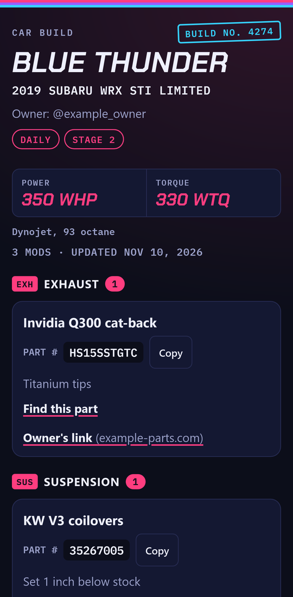
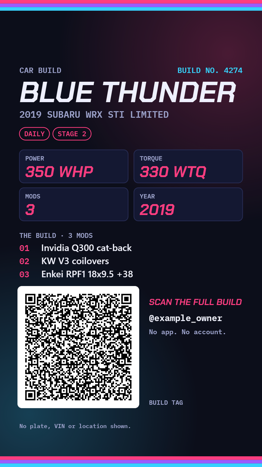
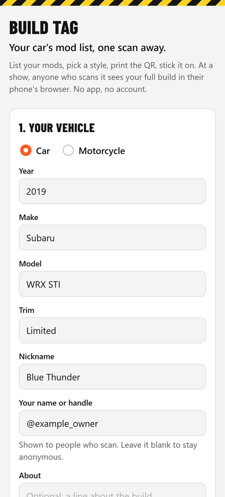
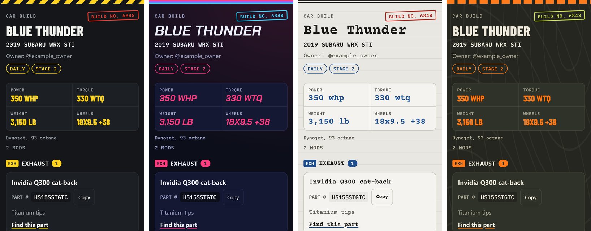
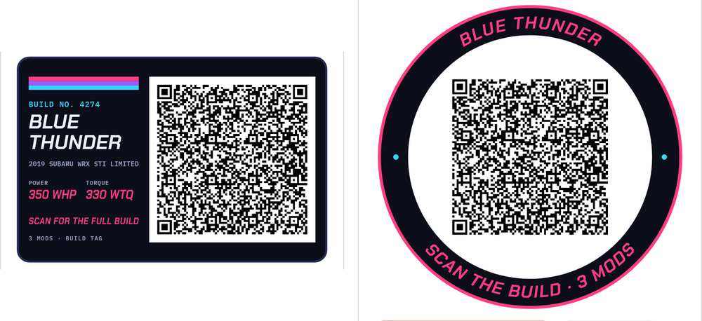

# Build Tag

**Your car's mod list, one scan away.** An owner lists the mods on a car or motorcycle and prints a QR sticker. At a car show, anyone who scans it sees the full build in their phone's browser: no app to install, no account, and no server holding anyone's data.

*Build Tag is a working name.*

| What a scan opens | The story share card | The owner's editor |
|---|---|---|
|  |  |  |

**Four styles from car culture** (Tech card, Night meet, Build sheet, Trail), each on the scan page, every print and the story card:



**Designed stickers:** a square, a 3:2 tech tag and a round slap, plus a letter-size dash card for big builds:



## The problem

At shows, people see a part they want and do not know what it is, and the owner is not always standing by the car. A sticker on the car that opens the full parts list, with part numbers to copy and a link to find each part, answers the question without the owner.

## How it works

```
owner's browser                                         a stranger's phone
───────────────                                         ──────────────────
build (car, style, specs, mods)                         camera reads the QR
  → JSON with short keys, mods as arrays                  → opens the page; the part after "#"
  → deflate-raw (CompressionStream)                         never leaves the phone
  → bytes written as digits (7 bytes → 17 digits)        → digits → bytes → inflate (capped at 64 KB)
  → link:  https://<site>/#1<digits>                      → every field cleaned, shown as plain text
  → QR: address in byte mode + digits in numeric mode
  → printed sticker or dash card
```

One static page does both jobs: with a build after `#` it shows the build, without one it opens the editor. The page is plain HTML, CSS and JavaScript modules with no build step, one vendored library (the QR encoder) and five self-hosted fonts (SIL Open Font License, in `fonts/`). A scan loads neither the editor nor the QR encoder: the scan page is 78 KB.

## Design decisions

**The build lives in the link.** Browsers do not send the part of a URL after `#` to the server, so the host only ever serves the same static files. That removes the database, the accounts, the server code and the data to protect, and the hosting bill stays flat as more people use it. The trade-off is that a printed sticker shows the build as it was when the QR was made: adding a mod means printing a new QR. Editable builds with a short permanent link would need a server, so they wait until owners ask for them.

**Every old sticker keeps working.** Version 0.2 added a style, up to four specs, a spec note and tags to the link. Each new field is written only when it is set (the default style is never written), so a build without them encodes to exactly the same digits as version 0.1, and every v0.1 link opens. Both are unit tests against a real v0.1 link.

**Digits instead of base64.** QR codes store digits in numeric mode at 3.33 bits each, so compressed bytes written as digits cost about 2% extra inside the QR, against 33% for base64 in byte mode. For a 25-mod build the QR drops from 137 to 117 squares a side, 27% fewer squares, which is what lets it fit a 4-inch sticker. Measured by `node tools/probe.mjs`:

| Mods | Link length | QR (digits) | QR (base64) |
|---:|---:|---:|---:|
| 1 | 510 | version 11, 61 squares | version 13, 69 squares |
| 10 | 1,266 | version 18, 89 squares | version 22, 105 squares |
| 25 | 2,300 | version 25, 117 squares | version 30, 137 squares |

**Print sizes come from the square size.** For each print (2, 3 and 4-inch squares, 3.5 and 6-inch tags, 3 and 4-inch round slaps, and a letter-size dash card) the app works out how wide one QR square prints, from how much of that shape the QR takes. At 0.8 mm or more it is easy to scan from arm's length; from 0.6 mm it scans from close up; below 0.6 mm the size is switched off. Each shape is graded on its own: a long list switches the round slap off (its QR is the smallest share of the sticker) while the 4-inch square and the 6-inch tag stay on. In practice about 25 mods with part numbers and short notes fit a 4-inch square; when every mod also carries a shop link, the build moves to the dash card, whose 6.5-inch QR prints squares of about 1.2 mm for that case (all unit tests). Whatever the style, the QR itself is black on a white panel with the standard 4-square border.

**Styles that stay out of the QR's way.** Each style is a set of colours, a heading font and a stripe (hazard stripes, neon bands, a typed rule, trail markers), applied to the scan page, the stickers and the story card. Downloaded SVG and PNG files carry their two fonts inside them, so a sticker printer sees the same lettering; the page itself never adds an inline style, which the Content-Security-Policy would refuse. The hazard stripe is drawn as clipped polygons rather than an SVG pattern: a pattern is found by id, and a printed sheet would otherwise borrow the hidden on-screen copy's pattern and print blank (a browser test prints a sheet and checks the stripe's colour).

**A story card that still scans after Instagram.** The 1080 x 1920 card is drawn on a canvas with whole pixels per QR square, never fewer than 4: most builds put the QR beside the specs; a dense build gets a wide QR and gives up the mod list. The browser test shrinks the card to half size, as a story app does, and decodes it. Phones that can share files open the share sheet; others download the PNG; the Android app saves it.

**Paste the list you already wrote.** Owners keep their mods in an Instagram caption or a forum post. The paste reader splits bullets, numbers, commas and headings ("WHEELS", "Interior:"), recognises over 250 aftermarket brands to split brand from part and guess the category, pulls part numbers from "P/N", brackets or SKU-like words, moves links out, reads "450whp / 400wtq" and "Weight: 3,150 lb" into the spec strip, drops hashtags, and shows every mod it found before adding them. It runs in the browser like everything else and is cleaned by the same rules as the form.

**iPhone first.** The person scanning needs nothing but the camera: the QR opens in Safari. Making and editing a build works in iPhone Safari too: the browser dry run runs on WebKit (26.6) with Playwright's iPhone 15 profile, on Chrome with the Android Pixel 7 profile, and on Edge. Android needs no separate app either. Before the site is public, `tools/phone.py` opens it on a paired Android phone through `adb reverse`: the PC serves on 127.0.0.1 only and the phone reaches it at `http://localhost:8765/` over the debugging link, so nothing is exposed to the network.

**An Android app from the same page.** `android/` is a 186 KB app (most of it the fonts) with one WebView and no libraries: it serves the page's own files from inside the app at Android's reserved `appassets.androidplatform.net` address (a secure origin, so ES modules and `CompressionStream` work offline), and opens every other link in the phone's browser. A small bridge, `window.BuildTagApp`, gives the page what a WebView lacks: saving the SVG, PNG, story card or backup to Downloads, printing through Android's print screen, and the clipboard. Inside the app the QR points at the public site, since the app's own address opens on no other phone. `python tools/android.py --toolchain <toolchain.json> --install` copies the page in, builds the debug APK with Gradle and installs it on a paired phone. A browser without `CompressionStream` gets a plain message asking for an update instead of a broken page. "Add to Home Screen" gives it an icon.

**Every scanned link is treated as hostile.** Anyone can make a link, so the viewer never renders HTML from it: text goes in as text nodes, only `http` and `https` links become clickable, every field is length-capped, decompression stops at 64 KB, and a strict Content-Security-Policy blocks inline scripts and any request to another site.

## Tests

- **54 unit tests** (`node:test`): the encoding round trip at every chunk length, a real v0.1 link opening and re-encoding to the same digits, damaged and foreign links, a compression bomb, hand-made hostile payloads (script links, objects, JSON nested 25,000 deep), links that hide the real site behind a login, input cleaning, print-size math per shape, every shape in every style escaping the owner's text and carrying a QR that a real decoder (jsQR) reads back to the exact link, and the paste reader on a real-looking caption.
- **A 69-check browser dry run, run three times** (`test/e2e.py`, Playwright): in WebKit with the iPhone 15 profile, in Chrome with the Android Pixel 7 profile, and in Edge on a phone-size screen, plus 8 checks of the Android app's bridge (QR to the public site, saving stickers and the story card, printing, copying), 215 checks in all. An owner picks a style, fills specs and builds a car; each sticker shape on screen is rasterised and decoded by jsQR; the decoded link is opened on a second, fresh phone in the owner's style. It also checks the downloads (fonts inside, nothing that runs, PNG size), the story card at full and half size, a dense build's story card, each style's colours, the v0.1 link, a pasted caption, script injection, damaged links, a 25-mod backup restore, which print sizes are switched off, printed sheets (including the hazard stripe), editing a copy on a new phone, page weight, and that nothing loads from another site or logs an error.

## Run it

```bash
npm install            # test-only dependencies: the QR encoder and decoder
npm test               # unit tests
python -m http.server 8765   # then open http://127.0.0.1:8765/
npm run test:e2e       # browser dry run; needs Python with Playwright, its WebKit, Chrome and Edge
python tools/phone.py --adb <path to adb>   # open it on a paired Android phone, no public site
```

## Next

- If owners at a show ask for it: editable builds behind a short permanent link (a small API and database), so a sticker never needs reprinting; photos; scan counts for the owner.
- Show mode: a QR on every registered car's dash card for a whole show.

## License

All rights reserved. The code is public to read; no license to reuse it is granted yet.
