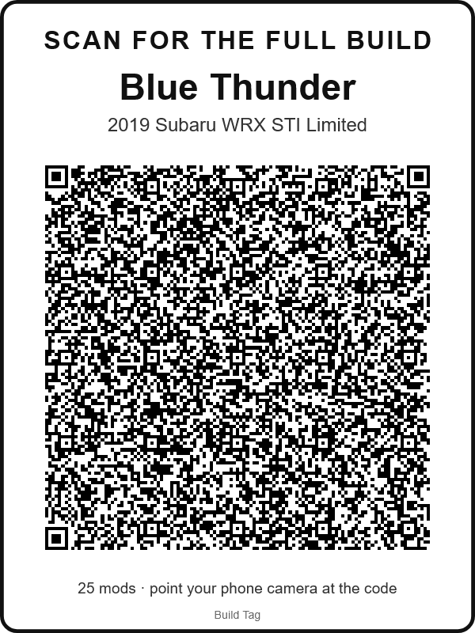

# Build Tag

**Your car's mod list, one scan away.** An owner lists the mods on a car or motorcycle and prints a QR sticker. At a car show, anyone who scans it sees the full build in their phone's browser: no app to install, no account, and no server holding anyone's data.

*Build Tag is a working name.*

| What a scan opens | The owner's editor | Dash card for big builds |
|---|---|---|
|  |  |  |

## The problem

At shows, people see a part they want and do not know what it is, and the owner is not always standing by the car. A sticker on the car that opens the full parts list, with part numbers to copy and a link to find each part, answers the question without the owner.

## How it works

```
owner's browser                                         a stranger's phone
───────────────                                         ──────────────────
build (car + mods)                                      camera reads the QR
  → JSON with short keys, mods as arrays                  → opens the page; the part after "#"
  → deflate-raw (CompressionStream)                         never leaves the phone
  → bytes written as digits (7 bytes → 17 digits)        → digits → bytes → inflate (capped at 64 KB)
  → link:  https://<site>/#1<digits>                      → every field cleaned, shown as plain text
  → QR: address in byte mode + digits in numeric mode
  → printed sticker or dash card
```

One static page does both jobs: with a build after `#` it shows the build, without one it opens the editor. The page is plain HTML, CSS and JavaScript modules with no build step and one vendored library (the QR encoder).

## Design decisions

**The build lives in the link.** Browsers do not send the part of a URL after `#` to the server, so the host only ever serves the same static files. That removes the database, the accounts, the server code and the data to protect, and the hosting bill stays flat as more people use it. The trade-off is that a printed sticker shows the build as it was when the QR was made: adding a mod means printing a new QR. Editable builds with a short permanent link are the plan for version 2.

**Digits instead of base64.** QR codes store digits in numeric mode at 3.33 bits each, so compressed bytes written as digits cost about 2% extra inside the QR, against 33% for base64 in byte mode. For a 25-mod build the QR drops from 137 to 117 squares a side, 27% fewer squares, which is what lets it fit a 4-inch sticker. Measured by `node tools/probe.mjs`:

| Mods | Link length | QR (digits) | QR (base64) |
|---:|---:|---:|---:|
| 1 | 510 | version 11, 61 squares | version 13, 69 squares |
| 10 | 1,266 | version 18, 89 squares | version 22, 105 squares |
| 25 | 2,300 | version 25, 117 squares | version 30, 137 squares |

**Print sizes come from the square size.** For each print (2, 3 and 4-inch stickers and a letter-size dash card) the app works out how wide one QR square prints. At 0.8 mm or more it is easy to scan from arm's length; from 0.6 mm it scans from close up; below 0.6 mm the size is switched off. In practice about 25 mods with part numbers and short notes fit a 4-inch sticker; when every mod also carries a shop link, the build moves to the dash card, whose 6.5-inch QR prints squares of about 1.2 mm for that case (both cases are unit tests).

**iPhone first.** The person scanning needs nothing but the camera: the QR opens in Safari. Making and editing a build works in iPhone Safari too: the browser dry run runs on WebKit (26.6) with Playwright's iPhone 15 profile as well as on Edge. A browser without `CompressionStream` gets a plain message asking for an update instead of a broken page. "Add to Home Screen" gives it an icon.

**Every scanned link is treated as hostile.** Anyone can make a link, so the viewer never renders HTML from it: text goes in as text nodes, only `http` and `https` links become clickable, every field is length-capped, decompression stops at 64 KB, and a strict Content-Security-Policy blocks inline scripts and any request to another site.

## Tests

- **33 unit tests** (`node:test`): the encoding round trip at every chunk length, damaged and foreign links, a compression bomb, hand-made hostile payloads, links that hide the real site behind a login, input cleaning, print-size math, and a real QR decoder (jsQR) reading the generated code back to the exact link.
- **A 39-check browser dry run, run twice** (`test/e2e.py`, Playwright): once in WebKit with the iPhone 15 profile and once in Edge on a phone-size screen, 78 checks in all. An owner builds a car, the sticker on screen is rasterised and decoded by jsQR, and the decoded link is opened on a second, fresh phone. It also checks script injection, damaged links, a 25-mod backup restore, which print sizes are switched off, printing, editing a copy on a new phone, page weight, and that nothing loads from another site or logs an error.

## Run it

```bash
npm install            # test-only dependencies: the QR encoder and decoder
npm test               # unit tests
python -m http.server 8765   # then open http://127.0.0.1:8765/
npm run test:e2e       # browser dry run; needs Python with Playwright, its WebKit, and Edge or Chrome
```

## Next

- Version 2: editable builds behind a short permanent link (a small API and database), so a sticker never needs reprinting; photos; scan counts for the owner.
- Show mode: a QR on every registered car's dash card for a whole show.

## License

All rights reserved. The code is public to read; no license to reuse it is granted yet.
